# CineBook — Movie Ticket Booking

Hệ thống đặt vé xem phim dạng monorepo, gồm **React/Vite frontend** và **NestJS modular monolith backend**. Dự án tập trung vào tính nhất quán khi giữ ghế, thanh toán và phát hành vé.

## Tính năng chính

- **Khách hàng:** tìm phim theo khu vực, xem trailer/lịch chiếu, chọn ghế và combo, sử dụng voucher được cấp, thanh toán SePay/VietQR, xem lịch sử booking và vé điện tử có QR.
- **Quản trị:** quản lý phim/rạp/phòng/ghế, nhập phim từ TMDB, lập lịch chiếu hàng loạt, quản lý combo/voucher, đối soát thanh toán và ghi nhận hoàn tiền thủ công.
- **Tài khoản:** xác thực email, đặt lại mật khẩu, quản lý phiên, phân quyền admin theo permission, lời mời quản trị và audit log.
- **Độ tin cậy:** Redis seat lock, PostgreSQL transaction/constraints, idempotency cho hold và webhook, email outbox với worker bất đồng bộ.

> Refund chỉ ghi nhận nghiệp vụ; admin chuyển tiền ngoài ứng dụng. QR vé dùng để xuất trình, chưa có check-in/consume. Xem [giới hạn hiện tại](./TECHNICAL.md#15-known-limitations-và-roadmap).

## Công nghệ

| Thành phần | Công nghệ |
| --- | --- |
| Frontend | React 19, Vite 8, TypeScript, plain CSS |
| Backend | NestJS 12, Express, TypeScript |
| Dữ liệu | PostgreSQL 17, Prisma 6, Redis 7 |
| Tích hợp | SePay, TMDB, SMTP |
| Kiểm thử | Vitest, Supertest, Playwright |
| Vận hành | Docker Compose, GitHub Actions, Prometheus metrics |

## Kiến trúc tổng quan



React SPA gọi NestJS modular monolith; PostgreSQL lưu trạng thái nghiệp vụ, Redis giữ lock ghế và mail worker xử lý email bất đồng bộ.

[Giải thích kiến trúc runtime](./TECHNICAL.md#24-kiến-trúc-runtime) · [Bản Archify HTML](./docs/architecture/runtime.html) (tải về để mở tương tác).

## Bắt đầu nhanh

### Yêu cầu

- Node.js **22.x** và npm.
- Docker Engine/Docker Desktop có Docker Compose để chạy PostgreSQL và Redis local.
- SMTP hợp lệ để gửi email. TMDB và SePay cần cấu hình riêng khi dùng các tích hợp đó.

### Cài đặt

Chạy từ thư mục gốc repository (Linux/macOS/Git Bash):

```bash
cp be/.env.example be/.env
cp fe/.env.example fe/.env
npm install
npm run install:all
```

Sửa `be/.env`: đặt hai JWT secret khác nhau, `SEED_ADMIN_PASSWORD` riêng và thông tin SMTP. Không commit `.env` hay dùng secret mẫu ở production. Nếu chưa dùng email local, có thể đặt `MAIL_WORKER_ENABLED=false`; đăng ký mới vẫn cần xác thực email để đăng nhập, nên dùng admin seed để khám phá trước.

```bash
npm run infra:up
npm run prisma:generate
npm run prisma:deploy
npm run prisma:seed
npm run dev
```

Trên PowerShell, thay hai lệnh `cp` bằng `Copy-Item`. Gặp lỗi Prisma/ICU trên Fedora với Node.js 22, xem [setup chi tiết](./TECHNICAL.md#141-setup-lần-đầu).

### Truy cập

| Dịch vụ | URL local |
| --- | --- |
| Frontend | <http://localhost:5173> |
| Admin login | <http://localhost:5173/admin/login> |
| API | <http://localhost:3000/api/v1> |
| Swagger | <http://localhost:3000/api/docs> (khi `SWAGGER_ENABLED=true`) |
| Readiness | <http://localhost:3000/api/v1/health/ready> |

Admin seed dùng email `SEED_ADMIN_EMAIL` (mặc định `admin@example.com`) và mật khẩu bạn đặt trong `SEED_ADMIN_PASSWORD`. Seed có phim, rạp, phòng, ghế và suất mẫu; không tạo customer hay booking. Chạy seed lại sẽ đồng bộ lại mật khẩu admin.

Frontend đọc `VITE_API_URL` trong `fe/.env`, mặc định `http://localhost:3000/api/v1`.

## Các lệnh thường dùng

| Lệnh | Tác dụng |
| --- | --- |
| `npm run dev` | Chạy backend và frontend |
| `npm run dev:be` / `npm run dev:fe` | Chạy riêng từng ứng dụng |
| `npm run infra:down` | Dừng PostgreSQL và Redis local |
| `npm run build` | Generate Prisma Client và build cả hai ứng dụng |
| `npm run check` | Lint, typecheck, build, unit/frontend/E2E tests |
| `npm run test:integration` | Integration tests trên Docker stack cô lập |
| `npm run test:browser:full` | Browser tests với API và infrastructure test thật |
| `npm run api:generate` / `npm run api:check` | Sinh / kiểm tra OpenAPI và frontend types |

Không chạy integration specs trực tiếp trên database development. Hướng dẫn Docker, migration, backup và deploy nằm trong [TECHNICAL.md](./TECHNICAL.md#14-cách-chạy-project).

## Cấu trúc repository

```text
be/          NestJS API, Prisma schema và migrations
fe/          React SPA
openapi/     OpenAPI contract được sinh từ backend
tests/       Browser tests
scripts/     Test runners, benchmark và công cụ vận hành
```

Mỗi package `be/` và `fe/` có dependencies và lockfile riêng; root scripts điều phối cả hai.

## Tài liệu

- [TECHNICAL.md](./TECHNICAL.md): kiến trúc, database, API, nghiệp vụ, concurrency, testing, cấu hình và vận hành.
- [DESIGN.md](./DESIGN.md): quy chuẩn giao diện.
- [WORKLOG.md](./WORKLOG.md): kế hoạch và ghi chú phát triển.
- [OpenAPI JSON](./openapi/ticket-booking.openapi.json): contract API được sinh từ backend.

## Đóng góp

Giữ đúng cấu trúc code hiện có và chạy các kiểm tra phù hợp (`npm run check`; thêm integration/browser tests cho luồng liên quan). Nếu đổi API, chạy `npm run api:generate`; không chỉnh tay generated files. Cập nhật `TECHNICAL.md` khi thay đổi hành vi, kiến trúc, database hoặc vận hành; README chỉ giữ giới thiệu và bắt đầu nhanh.

## Giấy phép

Repository chưa có file `LICENSE` ở thư mục gốc. Không mặc định coi mã nguồn là được cấp phép sử dụng lại; liên hệ chủ sở hữu để xác nhận. Dữ liệu và tài nguyên bên thứ ba tuân theo giấy phép tương ứng.
